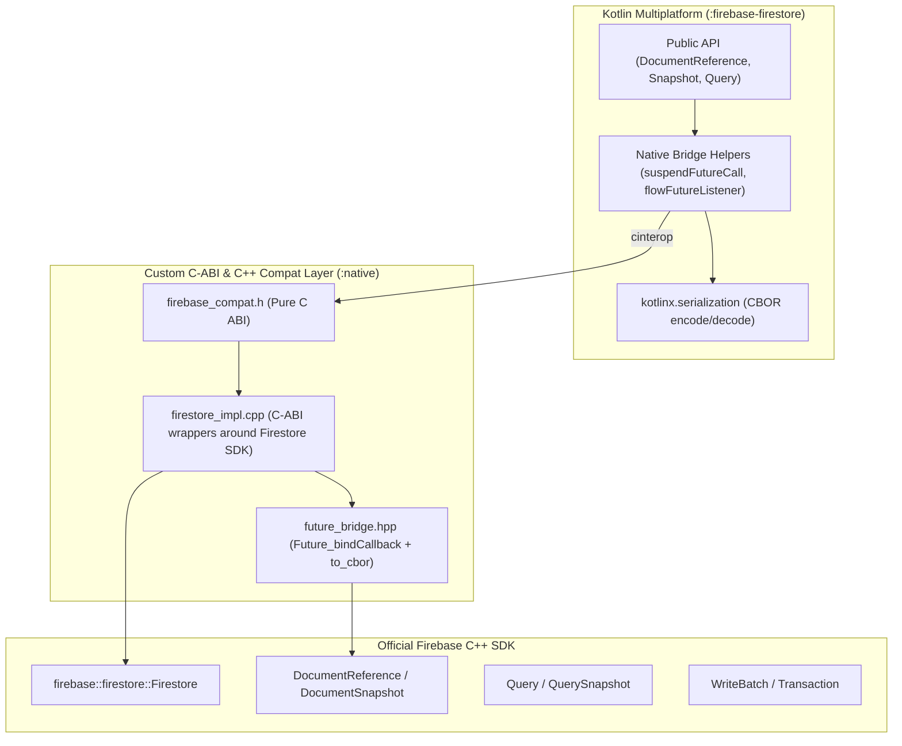

# Cloud Firestore Migration & Development Roadmap

This roadmap outlines the plan for migrating `:firebase-firestore` from the legacy `firebase_ffi` prototype to the official Firebase C++ SDK via our custom C-ABI layer (`firebase_compat.h` / `future_bridge.hpp`), followed by the implementation of all remaining Firestore features.

---

## 🏗️ Architecture Overview



---

# Part 1: Migration Guide for Currently Implemented Features

This section details the step-by-step migration of the Firestore features already implemented in Kotlin, moving away from `firebase_ffi` (`import fdb.*`, `FdbCallback`, `kn_bridge.h`) to our official C-ABI compat layer.

### Features Currently in Kotlin:
1. **Document Reference**: `id`, `snapshots` (without `metadataChanges`), `collection(subpath)`, `get()` (without `Source`), `set()` (without `SetOptions`), and `delete()`.
2. **Document Snapshot**: `exists`, `reference`, `data<T>()` (without `serverTimestampBehavior`).
3. **Firebase Firestore**: `document(path)`, `collection(path)`, `terminate()`.
4. **Firebase Firestore Settings**: `sslEnabled`, `host`, `cacheSettings`.
5. **Extension Property**: `Firebase.firestore` returning initialized `FirebaseFirestore`.
6. **Collection Reference**: `path`, `document()`, and `document(id)`.

---

### 1.1 C-ABI Header Declarations (`native/include/firebase_compat.h`)

Extend `firebase_compat.h` with Firestore types and C-ABI function signatures:

```c
#ifdef __cplusplus
namespace firebase {
namespace firestore {
class Firestore;
class DocumentReference;
class DocumentSnapshot;
class CollectionReference;
class ListenerRegistration;
}
}
typedef firebase::firestore::Firestore NativeFirestore;
typedef firebase::firestore::DocumentReference NativeDocRef;
typedef firebase::firestore::DocumentSnapshot NativeDocSnapshot;
typedef firebase::firestore::CollectionReference NativeColRef;
typedef firebase::firestore::ListenerRegistration NativeListenerRegistration;
extern "C" {
#else
typedef struct NativeFirestore NativeFirestore;
typedef struct NativeDocRef NativeDocRef;
typedef struct NativeDocSnapshot NativeDocSnapshot;
typedef struct NativeColRef NativeColRef;
typedef struct NativeListenerRegistration NativeListenerRegistration;
#endif

// Snapshot Listener Callbacks (for real-time snapshots)
typedef void (*SnapshotSuccessCallback)(
    void* user_data,
    const uint8_t* payload,
    size_t payload_len
);
typedef void (*SnapshotFailureCallback)(
    void* user_data,
    int error_code,
    const char* error_message
);

// --- Firestore Instance ---
NativeFirestore* Firestore_getInstance(NativeApp* app, const char* database_id);
NativeDocRef* Firestore_document(NativeFirestore* firestore, const char* path);
NativeColRef* Firestore_collection(NativeFirestore* firestore, const char* path);
void Firestore_terminate(
    NativeFirestore* firestore,
    void* user_data,
    FutureSuccessCallback on_success,
    FutureFailureCallback on_failure
);

// --- Firestore Settings ---
void Firestore_setSettings(
    NativeFirestore* firestore,
    const char* host,
    int ssl_enabled,
    int persistence_enabled,
    int64_t cache_size_bytes
);

// --- Collection Reference ---
const char* ColRef_getPath(const NativeColRef* col_ref);
NativeDocRef* ColRef_document(const NativeColRef* col_ref, const char* doc_path);
void ColRef_destroy(NativeColRef* col_ref);

// --- Document Reference ---
const char* DocRef_getId(const NativeDocRef* doc_ref);
const char* DocRef_getPath(const NativeDocRef* doc_ref);
NativeColRef* DocRef_getParent(const NativeDocRef* doc_ref);
NativeColRef* DocRef_collection(const NativeDocRef* doc_ref, const char* subpath);

void DocRef_get(
    NativeDocRef* doc_ref,
    void* user_data,
    FutureSuccessCallback on_success,
    FutureFailureCallback on_failure
);

void DocRef_set(
    NativeDocRef* doc_ref,
    const uint8_t* cbor_data,
    size_t len,
    int merge,
    void* user_data,
    FutureSuccessCallback on_success,
    FutureFailureCallback on_failure
);

void DocRef_delete(
    NativeDocRef* doc_ref,
    void* user_data,
    FutureSuccessCallback on_success,
    FutureFailureCallback on_failure
);

NativeListenerRegistration* DocRef_addSnapshotListener(
    NativeDocRef* doc_ref,
    void* user_data,
    SnapshotSuccessCallback on_snapshot,
    SnapshotFailureCallback on_error
);

void ListenerRegistration_remove(NativeListenerRegistration* registration);
void DocRef_destroy(NativeDocRef* doc_ref);

#ifdef __cplusplus
}
#endif
```

---

### 1.2 Native Implementation (`native/src/firestore_impl.cpp`)

Implement the C functions in C++ using `firebase::firestore::Firestore`, `future_bridge.hpp`, and `nlohmann::json`:

1. **`DocRef_get`**:
   - Calls `doc_ref->Get()`.
   - When the `Future<DocumentSnapshot>` completes:
     - If `snapshot.exists() == false`: invokes `on_success(user_data, nullptr, 0)`.
     - If `snapshot.exists() == true`: converts `snapshot.GetData()` into `nlohmann::json`, calls `future_bridge::to_cbor(j)`, and invokes `on_success(user_data, cbor.data(), cbor.size())`.
     - If error: invokes `on_failure(user_data, error_code, error_msg)`.

2. **`DocRef_set`**:
   - Takes incoming `cbor_data` and `len` from Kotlin.
   - Parses into `nlohmann::json` via `nlohmann::json::from_cbor(...)`.
   - Converts `nlohmann::json` into `firebase::firestore::MapFieldValue`.
   - Calls `doc_ref->Set(data, merge ? SetOptions::Merge() : SetOptions())`.
   - Uses `future_bridge::Future_bindCallback(future, on_success, on_failure, user_data)`.

3. **`DocRef_delete`**:
   - Calls `doc_ref->Delete()`.
   - Uses `future_bridge::Future_bindCallback(future, on_success, on_failure, user_data)`.

4. **`DocRef_addSnapshotListener`**:
   - Calls `doc_ref->AddSnapshotListener([callback, user_data](const DocumentSnapshot& snapshot, Error error, const std::string& error_msg) { ... })`.
   - Encodes snapshot payload as CBOR and forwards to `callback`.
   - Returns allocated heap wrapper around `ListenerRegistration`.

---

### 1.3 Kotlin/Native Coroutine Utilities Migration

Update `NativeCall.kt` in `firebase-firestore` to consume `FutureSuccessCallback` & `FutureFailureCallback`:

```kotlin
suspend fun <T : Any> suspendFutureCall(
    nativeCall: (
        userdata: COpaquePointer,
        onSuccess: FutureSuccessCallback,
        onFailure: FutureFailureCallback
    ) -> Unit,
    decodePayload: (ByteArray?) -> T
): T = suspendCancellableCoroutine { continuation ->
    val stableRef = StableRef.create(continuation)

    val onSuccess = staticCFunction { userdata: COpaquePointer?, payload: CPointer<UByteVar>?, len: size_t ->
        userdata!!.useAsStableRef<CancellableContinuation<T>> { cont ->
            val bytes = if (payload != null && len > 0u) payload.readBytes(len.toInt()) else null
            cont.resumeWith(runCatching { decodePayload(bytes) })
        }
    }

    val onFailure = staticCFunction { userdata: COpaquePointer?, errorCode: Int, errorMsg: CPointer<ByteVar>? ->
        userdata!!.useAsStableRef<CancellableContinuation<T>> { cont ->
            val msg = errorMsg?.toKString() ?: "Firestore operation failed ($errorCode)"
            cont.resumeWithException(FirestoreException.fromCode(errorCode, msg))
        }
    }

    nativeCall(stableRef.asCPointer(), onSuccess, onFailure)
}
```

---

### 1.4 Kotlin Classes Migration Checklist

- [ ] **Build Configuration (`build.gradle.kts`):**
  - Point `firebase-firestore` cinterop to `io.github.dangxuanthong.firebase.core.native` (or add firestore-specific cinterop for `firebase_compat.h`).
  - Remove all references to `packages/firebase_ffi` and `libfirebase_ffi`.
- [ ] **`Firestore.linuxX64.kt`:**
  - `Firebase.firestore`: Wrap `Firestore_getInstance(FirebaseApp.DEFAULT.nativePtr, null)`.
  - `CollectionReference`: Wrap `NativeColRef*` with `path` and `document(id)`.
- [ ] **`FirebaseFirestore.linuxX64.kt`:**
  - Hold pointer to `NativeFirestore*`.
  - `collection(path)` -> instantiate `CollectionReference(Firestore_collection(ptr, path))`.
  - `document(path)` -> instantiate `DocumentReference(Firestore_document(ptr, path))`.
  - `terminate()` -> call `Firestore_terminate` via `suspendFutureCall`.
- [ ] **`DocumentReference.linuxX64.kt`:**
  - Hold `NativeDocRef*` (or path string that resolves via Firestore).
  - Migrate `get()` to `suspendFutureCall` calling `DocRef_get`.
  - Migrate `set()` to `suspendFutureCall` calling `DocRef_set`.
  - Migrate `delete()` to `suspendFutureCall` calling `DocRef_delete`.
  - Migrate `snapshots` flow to `DocRef_addSnapshotListener` and `ListenerRegistration_remove`.
- [ ] **`DocumentSnapshot.linuxX64.kt`:**
  - `exists`: Check if data payload is non-null.
  - `data<T>()`: Decode CBOR byte array into `T` via `Cbor.decodeFromByteArray`.
- [x] **`FirebaseFirestoreSettings.linuxX64.kt`:**
  - Apply host, SSL, and cache size to native settings via `Firestore_setSettings`.

---

# Part 2: Unimplemented Firestore Features (Prioritized)

The remaining Cloud Firestore capabilities, sorted by necessity, priority, and dependency order:

| Priority | Category | Features | Target Complexity |
| :---: | :--- | :--- | :---: |
| **P1** | **Querying & Filtering** | Collection Queries, Filters (`whereEqualTo`, `in`, `array-contains`, `and`/`or`), Ordering, Limits | High |
| **P2** | **Query Snapshots & Changes**| `QuerySnapshot`, `DocumentChange` (Added, Modified, Removed), Query real-time flows | Medium |
| **P3** | **Batch Writes & Updates** | `DocumentReference.update()`, `SetOptions.merge()`, `WriteBatch` | Medium |
| **P4** | **FieldValue Sentinels** | `serverTimestamp()`, `increment()`, `arrayUnion()`, `arrayRemove()`, `delete()` | Medium |
| **P5** | **Transactions** | `runTransaction`: Interactive read-then-write transactions with automatic retries | High |
| **P6** | **Metadata & Sources** | `Source` (`DEFAULT`, `SERVER`, `CACHE`), `includeMetadataChanges`, `SnapshotMetadata` | Medium |
| **P7** | **Aggregation Queries** | `AggregateQuery`: `count()`, `sum()`, `average()` | Medium |
| **P8** | **Cache & Network Control** | `enableNetwork()`, `disableNetwork()`, `clearPersistence()`, `waitForPendingWrites()` | Low |
| **P9** | **Named Databases & Bundles** | Named database IDs (`(default)` vs custom), `loadBundle()`, `namedQuery()` | Low |

---

## 📍 Phase 1: Querying & Filtering (P1)

*Goal: Enable retrieving filtered and ordered subsets of collections.*

### 1.1 Query Filters
- [ ] **`whereEqualTo(field, value)`** / **`whereNotEqualTo(field, value)`**
- [ ] **`whereLessThan(field, value)`** / **`whereLessThanOrEqualTo(field, value)`**
- [ ] **`whereGreaterThan(field, value)`** / **`whereGreaterThanOrEqualTo(field, value)`**
- [ ] **`whereArrayContains(field, value)`** / **`whereArrayContainsAny(field, values)`**
- [ ] **`whereIn(field, values)`** / **`whereNotIn(field, values)`**
- [ ] **Composite Filters (`Filter.and(...)`, `Filter.or(...)`)**: Wraps `firebase::firestore::Filter::And` and `Filter::Or`.

### 1.2 Query Ordering & Pagination
- [ ] **`orderBy(field, direction)`**: Ascending / Descending.
- [ ] **`limit(n)`** and **`limitToLast(n)`**.
- [ ] **Cursor Pagination**: `startAt(snapshot / values)`, `startAfter(...)`, `endAt(...)`, `endBefore(...)`.

---

## 📍 Phase 2: Query Snapshots & Real-time Changes (P2)

*Goal: Represent query results and stream incremental collection modifications.*

### 2.1 Query Execution & Snapshot Data Structures
- [ ] **`Query.get()`**: Asynchronous execution returning `QuerySnapshot`.
- [ ] **`QuerySnapshot`**:
  - `documents: List<DocumentSnapshot>`
  - `documentChanges: List<DocumentChange>`
  - `empty: Boolean`, `size: Int`
  - `metadata: SnapshotMetadata`
- [ ] **`DocumentChange`**:
  - `type`: `DocumentChange.Type.ADDED`, `MODIFIED`, `REMOVED`.
  - `document: DocumentSnapshot`
  - `oldIndex: Int`, `newIndex: Int`

### 2.2 Real-time Query Listeners
- [ ] **`Query.snapshots` Flow**: Streaming updates via `Query::AddSnapshotListener`.
- [ ] CBOR protocol for encoding batch query changes efficiently between C++ and Kotlin.

---

## 📍 Phase 3: Partial Updates & Atomic Write Batches (P3)

*Goal: Enable atomic multi-document operations and partial updates without overwriting existing fields.*

### 3.1 Document Updates & Set Merging
- [ ] **`DocumentReference.update(data)`**: Calls `doc_ref->Update(MapFieldValue)`. Fails if document does not exist.
- [ ] **`SetOptions.merge()` & `SetOptions.mergeFields(...)`**: Updates specified fields or creates document if missing.

### 3.2 WriteBatch
- [ ] **`Firestore.batch()`**: Creates a `WriteBatch` instance.
- [ ] **`WriteBatch.set(docRef, data, setOptions)`**
- [ ] **`WriteBatch.update(docRef, data)`**
- [ ] **`WriteBatch.delete(docRef)`**
- [ ] **`WriteBatch.commit()`**: Returns `Future<void>`, executes all queued writes atomically against the server.

---

## 📍 Phase 4: `FieldValue` Transforms & Sentinels (P4)

*Goal: Support server-side transformations without race conditions.*

- [ ] **`FieldValue.serverTimestamp()`**: Resolves to server clock time upon commit.
- [ ] **`FieldValue.increment(value)`**: Numeric atomic increment (supports `Long` and `Double`).
- [ ] **`FieldValue.arrayUnion(elements...)`**: Atomically appends elements if not already present.
- [ ] **`FieldValue.arrayRemove(elements...)`**: Atomically deletes all matching elements.
- [ ] **`FieldValue.delete()`**: Deletes a specific field during an update operation.
- [ ] CBOR serialization tagging for `FieldValue` sentinels so Kotlin serializers can transmit transform directives to C++.

---

## 📍 Phase 5: Transactions (P5)

*Goal: Provide ACID read-then-write transactions with automatic server conflict resolution.*

- [ ] **`Firestore.runTransaction { transaction -> ... }`**:
  - Suspend function accepting a transactional execution lambda.
  - Parks/suspends Kotlin coroutine while C++ `Firestore::RunTransaction` coordinates the attempt.
  - Supports `transaction.get(docRef)`, `transaction.set(...)`, `transaction.update(...)`, `transaction.delete(...)`.
  - Automatically replays transaction block if server detects concurrency contention.

---

## 📍 Phase 6: Metadata & Source Discrimination (P6)

*Goal: Support offline data identification and fine-grained fetch control.*

- [ ] **`Source` Enum Integration**:
  - `Source.DEFAULT`: Attempts server, falls back to cache when offline.
  - `Source.SERVER`: Skips local cache, fails if offline.
  - `Source.CACHE`: Fetches strictly from local SQLite/LevelDB cache.
- [ ] **`SnapshotMetadata`**:
  - `hasPendingWrites: Boolean`: Indicates uncommitted local mutations.
  - `isFromCache: Boolean`: Indicates data was served from offline storage.
- [ ] **`snapshots(includeMetadataChanges: Boolean)`**:
  - When `true`, emits events when `hasPendingWrites` or `isFromCache` toggles, even if data didn't change.

---

## 📍 Phase 7: Aggregation Queries (P7)

*Goal: Perform server-side computations over collections without downloading documents.*

- [ ] **`Query.count()`**:
  - Wraps `query.Count().Get(AggregateSource::kServer)`.
  - Returns `AggregateQuerySnapshot.count: Long`.
- [ ] **`Query.aggregate(...)`**:
  - Supports `AggregateField.sum(...)` and `AggregateField.average(...)`.
  - Decodes aggregate results from CBOR integer/double payloads.

---

## 📍 Phase 8: Offline Persistence & Network Management (P8)

*Goal: Provide manual control over client connectivity and local storage.*

- [ ] **`Firestore.enableNetwork()`**: Re-enables network synchronization.
- [ ] **`Firestore.disableNetwork()`**: Disables all network traffic, serving all reads from cache and queuing writes locally.
- [ ] **`Firestore.clearPersistence()`**: Clears local offline cache.
- [ ] **`Firestore.waitForPendingWrites()`**: Resolves when all outstanding local writes have been acknowledged by the server.

---

## 📍 Phase 9: Multi-Database Support & Data Bundles (P9)

*Goal: Support advanced enterprise setups with multiple databases and pre-packaged data bundles.*

- [ ] **Named Database Support**:
  - `Firebase.firestore(databaseId: String)`: Access non-default Firestore instances within the same project.
- [ ] **Data Bundles**:
  - `Firestore.loadBundle(bundleData)`: Ingest pre-compiled document snapshots directly into cache.
  - `Firestore.namedQuery(queryName)`: Extract queries bundled with loaded bundles.
